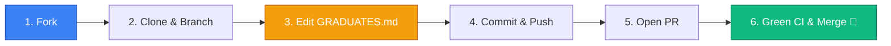

# 🎓 Зал славы выпускников (Graduates & Hall of Fame)

> **«Теория без практики мертва, практика без Open Source слепа».**  
> Поздравляем с завершением полного курса **«GitHub от А до Я»**! Вы освоили весь путь: от первого клика в браузере и консольного Git до CI/CD, релизов, архитектуры, вайбкодинга, мультиагентных триад и цитадели безопасности DevSecOps.  
> 
> Этот файл — не просто список имён. Это **интерактивный дипломный тренажёр твоего первого Pull Request в настоящий публичный Open Source проект**, созданный по канонам мирового бенчмарка [`first-contributions`](https://github.com/firstcontributions/first-contributions).

[](#)
[](CONTRIBUTING.md)
[](README.md)
[](#)

---

## 🧭 Навигация

1. [Зачем нужен этот тренажёр](#зачем-нужен-этот-тренажёр)
2. [Пошаговый тренажёр: Как сделать свой первый Pull Request](#пошаговый-тренажёр-как-сделать-свой-первый-pull-request)
3. [🏆 Зал славы выпускников (Таблица почёта)](#зал-славы-выпускников-таблица-почёта)
4. [Кодекс выпускника и правила гигиены](#кодекс-выпускника-и-правила-гигиены)
5. [Что делать дальше?](#что-делать-дальше)

---

## Зачем нужен этот тренажёр

Многие начинающие разработчики испытывают психологический барьер: *«А вдруг я нажму не туда и сломаю чужой репозиторий?», «А вдруг мой PR отклонят?»*.

Этот тренажёр создан, чтобы снять этот страх навсегда:
* **Абсолютно безопасно:** песочница специально предназначена для добавления вашего имени.
* **Реальный опыт:** вы проходите полный боевой цикл Open Source контрибьютора (Fork ➔ Branch ➔ Edit ➔ Commit ➔ Push ➔ Pull Request ➔ Automated CI Checks ➔ Merge).
* **Официальный след:** после слияния вашего PR вы навсегда становитесь официальным **Контрибьютором (Contributor)** репозитория с отображением в графе контрибьюторов GitHub.

---

## Пошаговый тренажёр: Как сделать свой первый Pull Request

Следуйте этой инструкции шаг за шагом. При возникновении сомнений сверяйтесь со **[Шпаргалкой разработчика (CHEATSHEET.md)](CHEATSHEET.md)**.



### Шаг 1: Форк репозитория (Fork)
1. Откройте репозиторий [thedoctormes-hue/github-a-to-z](https://github.com/thedoctormes-hue/github-a-to-z).
2. В правом верхнем углу нажмите кнопку **Fork** (создать копию репозитория в вашем личном профиле GitHub).
3. Оставьте настройки по умолчанию и нажмите **Create fork**.

### Шаг 2: Клонирование форка на ваш компьютер
Откройте ваш локальный терминал и склонируйте **ваш личный форк** (замените `<ваш-юзернейм>` на имя вашего аккаунта):

```bash
# Через SSH (рекомендуется):
git clone git@github.com:<ваш-юзернейм>/github-a-to-z.git

# Либо через HTTPS:
git clone https://github.com/<ваш-юзернейм>/github-a-to-z.git

# Перейдите в каталог проекта:
cd github-a-to-z
```

### Шаг 3: Создание изолированной ветки
Никогда не коммитьте напрямую в `main`. Создайте новую семантическую ветку для вашего диплома:

```bash
git switch -c graduate/<ваш-юзернейм>
```

### Шаг 4: Внесение записи в таблицу `GRADUATES.md`
Откройте файл `GRADUATES.md` в любом редакторе (VS Code, Nano, Vim или в браузере) и добавьте **ровно одну строку в самый конец таблицы** в разделе [🏆 Зал славы выпускников](#зал-славы-выпускников-таблица-почёта).

Формат строки:
```markdown
| [@ваш-юзернейм](https://github.com/ваш-юзернейм) | Ваше Имя / Ник | 🎓 Выпускник | Модуль XX (Название) | ГГГГ-ММ-ДД | [Мой проект / Профиль](ссылка) |
```

> [!IMPORTANT]
> **Золотые правила гигиены Open Source:**
> 1. Добавляйте запись **строго в конец таблицы** — это гарантирует отсутствие конфликтов слияния (Merge Conflicts) с другими студентами.
> 2. Не модифицируйте и не удаляйте строки других участников.
> 3. Убедитесь, что все указанные ссылки валидны и открываются без ошибок.

### Шаг 5: Семантический коммит (Conventional Commits)
Зафиксируйте изменения строго по стандарту Conventional Commits:

```bash
git add GRADUATES.md
git commit -m "docs(graduates): add @<ваш-юзернейм> to Hall of Fame"
```

### Шаг 6: Отправка ветки в ваш форк на GitHub
Отправьте ветку с изменениями в удалённый репозиторий вашего форка:

```bash
git push -u origin graduate/<ваш-юзернейм>
```

### Шаг 7: Открытие Pull Request в основной репозиторий
1. Перейдите на страницу вашего форка на GitHub: `https://github.com/<ваш-юзернейм>/github-a-to-z`.
2. Вверху появится желтая плашка с кнопкой **Compare & pull request** — нажмите её.
3. Убедитесь, что базовым репозиторием выбран `thedoctormes-hue/github-a-to-z`, а базовой веткой — `main`.
4. В поле названия укажите: `docs(graduates): add @<ваш-юзернейм> to Hall of Fame`.
5. Заполните чек-лист в описании PR и нажмите **Create pull request**!

### Шаг 8: Зеленый конвейер CI и вступление в ряды контрибьюторов
* Автоматический CI-конвейер GitHub Actions запустит валидатор целостности ссылок и проверку безопасности CodeQL.
* После успешного прохождения автоматических тестов мейнтейнер проекта сольёт ваш PR в ветку `main`.
* **Поздравляем!** Ваше имя навсегда вписано в историю проекта, а в вашем профиле GitHub появится статус официального контрибьютора!

---

## 🏆 Зал славы выпускников (Таблица почёта)

| Участник (GitHub) | Имя / Позывной | Статус | Любимый модуль | Дата выпуска | Дипломный проект / Профиль |
| :--- | :--- | :--- | :--- | :--- | :--- |
| [@thedoctormes-hue](https://github.com/thedoctormes-hue) | DoctorM | 🎖️ Автор & Архитектор курса | Все 14 модулей | 2026-10-12 | [GitHub от А до Я](https://github.com/thedoctormes-hue/github-a-to-z) |
| [@TheNovaNodes](https://github.com/TheNovaNodes) | TheNovaNodes Штаб | 🛡️ Экосистема & Инфраструктура | Модуль 14: Security & Insights | 2026-10-12 | [TheNovaNodes Network](https://github.com/TheNovaNodes) |
| [@MataHari_gobot](https://github.com/thedoctormes-hue) | Мата Хари | 👁️ Разведка & Криптоанализ | Модуль 12 & 13: AI & MCP | 2026-10-13 | [AI-Agent Triad Defense](https://github.com/thedoctormes-hue/github-a-to-z) |

---

## Кодекс выпускника и правила гигиены

Все выпускники обязуются соблюдать высокие инженерные стандарты:
1. **Уважение и профессионализм:** следовать **[Кодексу поведения (CODE_OF_CONDUCT.md)](CODE_OF_CONDUCT.md)**.
2. **Нулевая терпимость к спаму:** запрещается размещение реферальных ссылок, рекламы сомнительных финансовых инструментов или нерелевантного контента.
3. **Принцип взаимопомощи:** помогайте начинающим студентам в [GitHub Discussions](https://github.com/thedoctormes-hue/github-a-to-z/discussions) и делитесь лучшими практиками.

---

## Что делать дальше?

После закрепления вашего диплома в Зале славы перед вами открыты все двери:
* 🌟 **Поставьте звезду (Star)** репозиторию курса, если он помог вам освоить Git и GitHub.
* 📢 **Расскажите о своём достижении:** опубликуйте пост в LinkedIn, Telegram или X/Twitter со ссылкой на ваш первый Pull Request.
* 🚀 **Контрибьютьте в большой Open Source:** переходите к тикетам с лейблом `good first issue` в мировых проектах и применяйте полученные навыки DevSecOps и ИИ-кодинга на практике!
