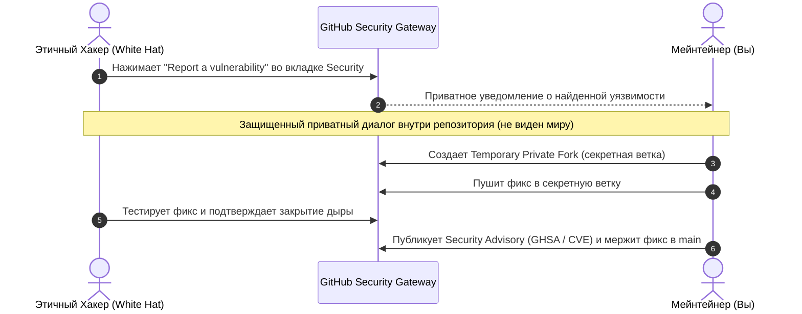

# 🛡️ Модуль 14: Цитадель безопасности & Телеметрия штаба (Security and quality, Insights, CodeQL, SBOM и OSINT репозитория)

> **«Тот, кто строит замок без дозорных башен и рва с водой, строит не крепость, а общую могилу».**  
> До сих пор мы учились писать код, настраивать CI/CD, версионировать релизы и дирижировать ИИ-агентами. Но как защитить проект от изощренных кибератак, уязвимостей нулевого дня и как измерить его реальный пульс и охват в мировом сообществе?  
> Для этого в GitHub служат два ключевых пульта управления: **Security and quality** (Оборона & Контрразведка) и **Insights** (Аналитический радар & OSINT).

---

## 🧭 Навигация по модулю

1. [Анатомия вкладок: Зачем нужны Security and quality и Insights](#1-анатомия-вкладок-зачем-нужны-security-and-quality-и-insights)
2. [Раздел Security and quality: Эшелонированная оборона](#2-раздел-security-and-quality-эшелонированная-оборона)
   - [2.1. Политика безопасности (SECURITY.md) & Responsible Disclosure](#21-политика-безопасности-securitymd-responsible-disclosure)
   - [2.2. Приватные репорты (Private Vulnerability Reporting)](#22-приватные-репорты-private-vulnerability-reporting)
   - [2.3. GitHub Security Advisories (GHSA) & Регистрация CVE](#23-github-security-advisories-ghsa-регистрация-cve)
   - [2.4. Сканирование секретов (Secret Scanning) & Push Protection](#24-сканирование-секретов-secret-scanning-push-protection)
   - [2.5. Статический SAST-анализ кода (Code Scanning & CodeQL)](#25-статический-sast-анализ-кода-code-scanning-codeql)
   - [2.6. Dependabot & Паспорт компонентов SBOM (Software Bill of Materials)](#26-dependabot-паспорт-компонентов-sbom-software-bill-of-materials)
3. [Раздел Insights: Аналитический радар и OSINT репозитория](#3-раздел-insights-аналитический-радар-и-osint-репозитория)
   - [3.1. Pulse: Пульс проекта за 24ч, 7 дней и месяц](#31-pulse-пульс-проекта-за-24ч-7-дней-и-месяц)
   - [3.2. Contributors & Оценка Bus Factor (Фактора автобуса)](#32-contributors-оценка-bus-factor-фактора-автобуса)
   - [3.3. Community Standards: Официальный скоринг зрелости репозитория](#33-community-standards-официальный-скоринг-зрелости-репозитория)
   - [3.4. Traffic: Легальный OSINT посетителей, Top Referrers и Popular Content](#34-traffic-легальный-osint-посетителей-top-referrers-и-popular-content)
   - [3.5. Commits & Code Frequency: Кардиограмма кодовой базы](#35-commits-code-frequency-кардиограмма-кодовой-базы)
   - [3.6. Dependency Graph & Связность «Used by»](#36-dependency-graph-связность-used-by)
   - [3.7. Network Graph & Разведка форков (Forks)](#37-network-graph-разведка-форков-forks)
   - [3.8. Actions Usage & Performance Metrics: Экономика CI/CD](#38-actions-usage-performance-metrics-экономика-cicd)
4. [Чеклист безопасности и телеметрии перед выходом в Public](#4-чеклист-безопасности-и-телеметрии-перед-выходом-в-public)
5. [Переход к практике](#5-переход-к-практике)

---

## 1. Анатомия вкладок: Зачем нужны Security and quality и Insights

В верхнем меню любого репозитория GitHub рядом с кодом и задачами расположены две вкладки:

```text
┌──────┬────────┬───────────────┬────────┬─────────┬──────────┬──────────────────────┬──────────┬──────────┐
│ Code │ Issues │ Pull requests │ Agents │ Actions │ Projects │ Security and quality │ Insights │ Settings │
└──────┴────────┴───────────────┴────────┴─────────┴──────────┴──────────────────────┴──────────┴──────────┘
                                                                        ▲                  ▲
                                                                  Щит и Броня       Радар и Телеметрия
```

* **Security and quality (Безопасность и Качество):**  
  Инструменты проактивной защиты. Они не ждут, пока злоумышленник взломает ваш сервер или выкачает базу данных. Они анализируют зависимости, выявляют уязвимости в логике кода (SAST), перехватывают случайные утечки API-токенов и обеспечивают приватный коридор для общения с исследователями безопасности.
* **Insights (Аналитика и Телеметрия):**  
  Бортовой компьютер и радар проекта. Показывает, сколько людей читают проект, откуда они приходят (Google, Reddit, Habr, Telegram), кто из контрибьюторов тащит разработку, какова активность веток и форков, и соответствует ли проект мировым стандартам качества (Community Standards).

---

## 2. Раздел Security and quality: Эшелонированная оборона

Современная кибербезопасность строится по принципу эшелонированной защиты (Defense-in-Depth). Рассмотрим каждый рубеж обороны.

### 2.1. Политика безопасности (SECURITY.md) & Responsible Disclosure

> [!CAUTION]
> **Смертный грех исследователя и пользователя:** публикация информации об уязвимости, эксплойте или векторе взлома в открытый публичный **GitHub Issue**.  
> С момента публикации открытого тикета до момента создания ботами эксплойта для массового сканирования интернета проходит от 15 минут до 2 часов. Вы фактически дарите злоумышленникам бесплатный 0-day эксплойт!

Чтобы этого не происходило, в корне проекта размещается официальный файл **`SECURITY.md`**.

#### Что содержит эталонный `SECURITY.md`:
1. **Поддерживаемые версии (Supported Versions):** четкая таблица, какие релизы получают патчи безопасности (например, только `v1.x`, а устаревшие `v0.x` не поддерживаются).
2. **Канал сообщения (Reporting a Vulnerability):** прямой запрет на Issues и четкая инструкция:
   * Использовать кнопку **Private Vulnerability Reporting** прямо на GitHub.
   * Либо отправить письмо на специальный защищенный ящик безопасности (`security@yourdomain.com`).
3. **PGP-ключ для шифрования:** если проект работает с критической инфраструктурой.
4. **Сроки реакции (SLA):** обещание ответить в течение 24–48 часов и предоставить план исправления.
5. **Safe Harbor (Безопасная гавань):** юридическое обещание не преследовать этичного хакера в суде, если он действовал добросовестно, не разрушал данные и не раскрывал уязвимость публично до выпуска патча.

---

### 2.2. Приватные репорты (Private Vulnerability Reporting)

Раньше белому хакеру приходилось искать личную почту автора проекта, рискуя попасть в спам.  
В современных репозиториях GitHub существует встроенный механизм: **Private Vulnerability Reporting (PVR)**.



1. Исследователь переходит во вкладку **Security and quality** ➔ **Advisories** ➔ нажимает кнопку **Report a vulnerability**.
2. Создается изолированный черновик, доступный только исследователю и мейнтейнерам проекта.
3. Никто в интернете не видит эту дискуссию до тех пор, пока уязвимость не будет закрыта.

---

### 2.3. GitHub Security Advisories (GHSA) & Регистрация CVE

Когда уязвимость подтверждена:
1. GitHub позволяет в один клик создать **Temporary Private Fork** — секретный форк репозитория, где мейнтейнер и исследователь пишут и тестируют патч безопасности без риска утечки в открытый код.
2. Прямо из интерфейса GitHub мейнтейнер может нажать **Request CVE identification number** — GitHub является официальным CVE Numbering Authority (CNA) и бесплатно присваивает проекту международный идентификатор уязвимости (например, `CVE-2026-12345`).
3. При релизе патча нажимается кнопка **Publish advisory**:
   * Создается запись в базе **GitHub Advisory Database (GHSA)**.
   * Новость транслируется в мировые базы безопасности (NVD / NIST).
   * Всем зависимым проектам в мире робот Dependabot моментально отправляет предупреждение об опасности!

---

### 2.4. Сканирование секретов (Secret Scanning) & Push Protection

Человеческий фактор неизбежен: уставший инженер может случайно скопировать в код строку `sk-proj-99a8b7c6d5e4...` (токен OpenAI) или приватный SSH-ключ.

* **Secret Scanning:** облачный радар сканирует историю коммитов по регулярным выражениям и алгоритмам оценки энтропии Шеннона. Если обнаружен ключ известного провайдера (GitHub, AWS, OpenAI, Stripe, Google Cloud, Slack), GitHub за секунды связывается с провайдером через **Secret Scanning Partner Program**, и провайдер автоматически инвалидирует (отзывает) скомпрометированный ключ!
* **Push Protection (Защита при пуше):** активный барьер. Если разработчик выполняет `git push`, а в диффе содержится боевой токен, GitHub **отклоняет push** с ошибкой прямо в терминале и предлагает удалить секрет из истории до отправки.

---

### 2.5. Статический SAST-анализ кода (Code Scanning & CodeQL)

> [!CAUTION]
> **⚠️ Главная ловушка новичка: Тарифные условия CodeQL**  
> Семантический сканер CodeQL полностью **бесплатен только для публичных репозиториев (Public)**.  
> Если запустить воркфлоу CodeQL в **приватном репозитории на бесплатном тарифе Free**, джоб мгновенно упадет с системной ошибкой:  
> `Code scanning is not enabled for this repository`.  
> В приватных репозиториях сканирование кода требует коммерческой лицензии *GitHub Advanced Security (GHAS)*. Не пытайтесь запускать CodeQL в закрытых учебных проектах — переводите проект в Public либо используйте легковесные открытые линтеры (например, линтеры на Python/Node.js).

Традиционные линтеры (Flake8, ESLint) проверяют стиль кода и простые опечатки.  
**CodeQL** — это принципиально иной уровень. Это движок семантического анализа исходного кода, разработанный GitHub / Semmle.

#### Как работает CodeQL:
1. **Код превращается в реляционную базу данных:** AST (дерево абстрактного синтаксиса), граф потока данных (Data Flow Graph) и граф вызовов функций (Control Flow Graph) извлекаются и индексируются.
2. **Запросы на языке QL:** специальные запросы на декларативном языке ищут опасные цепочки:
   * **Source (Источник):** откуда приходят нефильтрованные данные от пользователя (параметр HTTP-запроса, поле формы, заголовки).
   * **Taint Propagation (Распространение заражения):** как эти данные путешествуют по переменным и функциям.
   * **Sink (Точка поражения):** куда эти данные попадают (вызов SQL-запроса `db.execute()`, вставка в HTML `innerHTML`, выполнение системной команды `exec()`).
3. Если путь от **Source** к **Sink** проходит без очистки/санитизации (Sanitizer), CodeQL объявляет тревогу: **SQL Injection**, **Remote Code Execution (RCE)** или **Cross-Site Scripting (XSS)**.

Включается добавлением простого GitHub Action `.github/workflows/codeql.yml`.

> [!TIP]
> **Архитектурная чистота матрицы сканирования:**  
> CodeQL требует наличия в проекте исходного кода для каждого языка, указанного в матрице (`strategy.matrix.language`). Включайте в матрицу только те языки, которые фактически присутствуют в репозитории (в нашем учебном курсе сканируются Python-скрипты автоматизации `scripts/validate_links.py`). Если оставить шаблонный язык без единого файла кода, сканер завершится ошибкой отсутствия базы данных (`No source code was seen`).

---

### 2.6. Dependabot & Паспорт компонентов SBOM (Software Bill of Materials)

90% современного приложения состоит не из вашего кода, а из сторонних библиотек (npm, pip, cargo, go modules).

* **Dependency Graph:** анализирует ваши манифесты (`package.json`, `requirements.txt`, `Cargo.lock`) и строит точное дерево прямых и транзитивных (зависимости зависимостей) библиотек.
* **Dependabot Alerts:** сопоставляет дерево зависимостей с базой GHSA. Если библиотека версии `1.2.0` признана уязвимой, появляется алерт с указанием степени опасности (Low, Moderate, High, Critical) и рекомендацией безопасной версии (например, `1.2.4`).
* **SBOM (Software Bill of Materials):** цифровой паспорт и опись всех «ингредиентов» вашего ПО. С 2021 года (после указа президента США EO 14028) поставка коммерческого ПО без SBOM запрещена во многих секторах. GitHub позволяет выгрузить SBOM в международных форматах **SPDX** или **CycloneDX** в один клик прямо из вкладки Insights.

---

## 3. Раздел Insights: Аналитический радар и OSINT репозитория

Вкладка **Insights** — это телеметрический центр. Пройдемся по всем пунктам левого меню.

### 3.1. Pulse: Пульс проекта за 24ч, 7 дней и месяц

**Pulse** дает моментальный оперативный срез активности:
* Сколько Pull Requests было влито (Merged) и сколько открыто (Open).
* Сколько Issues закрыто и сколько создано.
* Активность веток и список самых активных контрибьюторов за выбранный период.

> [!TIP]
> **Применение в штабе:** перед еженедельным командным синком или отчетом руководству не нужно опрашивать всех инженеров. Достаточно открыть Pulse ➔ `1 week` и скопировать готовые цифры прогресса.

---

### 3.2. Contributors & Оценка Bus Factor (Фактора автобуса)

Раздел **Contributors** визуализирует активность каждого участника в виде временных рядов (коммиты, добавленные и удаленные строки).

#### 🚌 Что такое Bus Factor (Фактор автобуса)?
> **Bus Factor проекта** — это минимальное число ключевых разработчиков команды, при внезапном исчезновении которых («если их завтра собьет автобус» или они просто уволятся) проект перестанет развиваться и умрет из-за утраты уникальных знаний.

```text
Опасный проект (Bus Factor = 1):
[Разработчик А] ████████████████████████████████████ 98% коммитов
[Разработчик Б] █ 2% коммитов
⚠️ КРИТИЧЕСКИЙ РИСК: Уход Разработчика А останавливает жизнь проекта.

Здоровый проект (Bus Factor = 3+):
[Инженер 1]     ██████████████ 35%
[Инженер 2]     ███████████ 30%
[Инженер 3]     ████████ 20%
[Сообщество]    ██████ 15%
✅ НАДЕЖНОСТЬ: Знания и архитектура распределены гармонично.
```

Вкладка Contributors позволяет мгновенно оценить Bus Factor вашего проекта по графикам коммитов.

---

### 3.3. Community Standards: Официальный скоринг зрелости репозитория

GitHub автоматически проверяет репозиторий по чеклисту зрелости Open Source проекта (**Community Standards Checklist**):

```text
┌─────────────────────────────────────────────────────────────┐
│ Community Standards Profile                         100%    │
├─────────────────────────────────────────────────────────────┤
│  ✅ Description          (Краткое описание в About)         │
│  ✅ README               (README.md в корне проекта)        │
│  ✅ Code of Conduct      (CODE_OF_CONDUCT.md)               │
│  ✅ Contributing         (CONTRIBUTING.md)                  │
│  ✅ License              (LICENSE файл)                     │
│  ✅ Issue templates      (.github/ISSUE_TEMPLATE/)          │
│  ✅ Pull request template(.github/PULL_REQUEST_TEMPLATE.md) │
│  ✅ Security policy      (SECURITY.md)                      │
└─────────────────────────────────────────────────────────────┘
```

Если у вас нет `SECURITY.md` или `.github/PULL_REQUEST_TEMPLATE.md`, ваш рейтинг застревает на 75–85%.  
Для профессионального взгляда опытного инженера или HR-техлида проект без 100% скоринга выглядит недоделанным черновиком.

---

### 3.4. Traffic: Легальный OSINT посетителей, Top Referrers и Popular Content

Это один из самых увлекательных разделов для автора проекта.

#### Ключевые метрики:
1. **Views & Unique Visitors:** общее число просмотров страниц против уникальных IP/аккаунтов. Если 100 просмотров сделали 2 уникальных посетителя — это просто вы обновляли страницу 98 раз.
2. **Clones & Unique Cloners:** сколько раз проект клонировали через `git clone`. Уникальные клонеры — это люди, которые реально скачали ваш код на свою машину для сборки или анализа!
3. **Top Referrers (Источники трафика):**  
   Радар показывает домены, откуда переходят люди:
   * `google.com` / `yandex.ru` — органический поисковый трафик.
   * `habr.com` / `reddit.com` / `t.me` — переходы из статей и соцсетей.
   * `github.com` — внутренний поиск и каталоги трендов.
4. **Popular Content:**  
   Список конкретных файлов и путей, которые читают чаще всего (например, `docs/04-security-opsec/README.md` или `labs/lab-12-ai-mcp/README.md`).

> [!WARNING]
> **Ловушка 14 дней:**  
> GitHub удаляет статистику трафика старше **14 дней**! Если вы выпустили релиз или написали вирусную статью на Хабре, через две недели все данные о пиковом трафике сотрутся навсегда.  
> *Решение профессионалов:* настроить GitHub Action (например, `github-repo-stats` или cron-скрипт), который раз в сутки через GitHub API забирает трафик и сохраняет его в отдельную ветку или базу данных.

---

### 3.5. Commits & Code Frequency: Кардиограмма кодовой базы

* **Commits:** распределение коммитов по дням недели и времени суток. Показывает, в какие дни команда работает продуктивнее всего.
* **Code Frequency:** еженедельный баланс добавленных (зеленая зона выше нуля) и удаленных (красная зона ниже нуля) строк кода.  
  * *Симптом хорошего кода:* периодические глубокие красные провалы. Это значит, что команда проводит рефакторинг и безжалостно удаляет мертвый легаси-код, а не только бесконечно накапливает слои «спагетти».

---

### 3.6. Dependency Graph & Связность «Used by»

* Вкладка **Dependencies** показывает все пакеты, от которых зависит проект.
* Вкладка **Dependents (Used by):** показывает другие публичные репозитории на GitHub и пакеты, которые импортируют ваш код. Это высший знак признания проекта в индустрии.

---

### 3.7. Network Graph & Разведка форков (Forks)

**Network Graph** — это интерактивная топологическая карта:
* Горизонтальные линии показывают коммиты во времени.
* Разветвления показывают ветки и форки.
* Если кто-то сделал форк вашего репозитория и втайне пишет там интересную фичу или исправляет баг, которого вы еще не заметили — радар Network моментально покажет его коммит на карте! Вы можете изучить его код и предложить ему открыть Pull Request.

---

### 3.8. Actions Usage & Performance Metrics: Экономика CI/CD

Вкладка для контроля бюджета и оптимизации:
* **Actions usage metrics:** сколько минут из бесплатного месячного лимита (2000 минут для Private репозиториев) потратил каждый воркфлоу.
* **Actions performance metrics:** среднее время выполнения сборок и процент успешных прогонов. Помогает сразу выявить шаги, замедляющие разработку (bottlenecks).

> [!TIP]
> **Применение OSINT и аудита к чужим проектам:**  
> Чтобы применить полученные навыки анализа Insights, поиска уязвимостей и проверки зависимостей на практике за 60 секунд, изучите наш отдельный **[Спецгайд по скоростной разведке чужих репозиториев](../repo-reconnaissance.md)**.

---

## 4. Чеклист безопасности и телеметрии перед выходом в Public

Перед тем как нажать переключатель `Make Public` в настройках репозитория, проведите обязательный аудит:

- [ ] В корне репозитория создан официальный файл **`SECURITY.md`** с политикой Responsible Disclosure.
- [ ] Включен **Private Vulnerability Reporting** в настройках *Security and quality*.
- [ ] Активирована зеленая кнопка **Enable the dependency graph** и включены алерты Dependabot.
- [ ] Включен **Secret scanning** и **Push protection**.
- [ ] В `.github/` добавлен шаблон **`PULL_REQUEST_TEMPLATE.md`**.
- [ ] Скоринг в разделе **Insights ➔ Community Standards** составляет **100%**.
- [ ] Настроен базовый воркфлоу **CodeQL Analysis** для статического анализа безопасности.

---

## 5. Переход к практике

Теория усвоена, оборонительные доктрины ясны. Время занять боевые посты и настроить систему безопасности и телеметрии своими руками:

👉 **[Перейти к Лабораторной работе №14: Цитадель безопасности & Разведка телеметрии](../../labs/lab-14-security-insights/README.md)** 🧪

---

## 🎓 Выпускной рубеж: Зал славы

После успешного выполнения всех лабораторных работ курса закрепите свой успех на практике — подайте свой первый боевой Pull Request в репозиторий:

👉 **[Внести своё имя в Зал славы выпускников (GRADUATES.md)](../../GRADUATES.md)** 🏆
