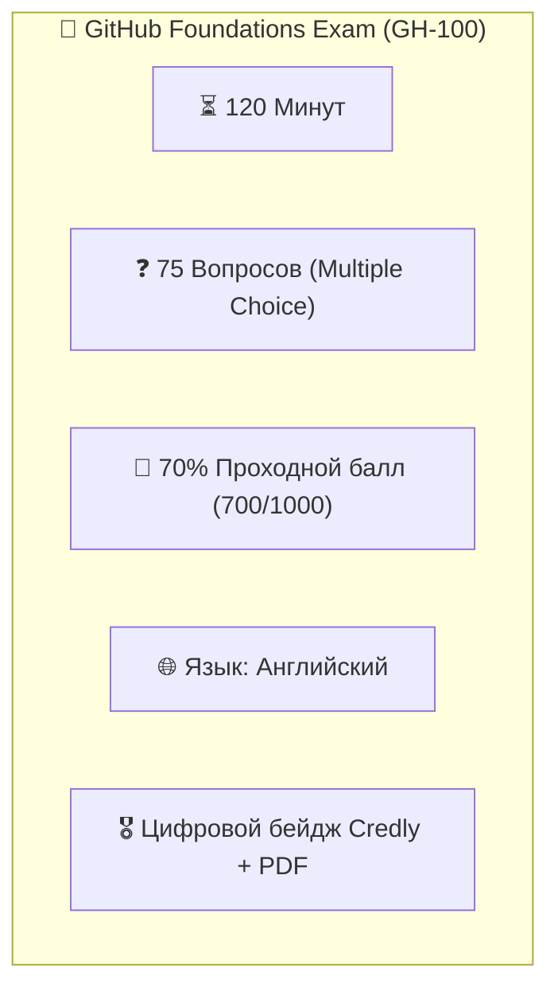
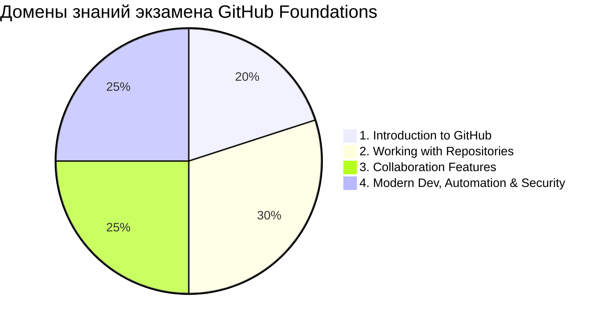

# 🏅 Подготовка к сертификации GitHub Foundations

> **«Сертификат не заменяет мастерства, но открывает двери, за которыми ждут настоящие задачи.»**  
> *— Из наставлений Офицера Разведки*

Добро пожаловать в специальный модуль подготовки к официальному международному экзамену **GitHub Foundations Certification**!

Если вы прошли модули и лаборатории курса **«GitHub от А до Я»**, вы уже обладаете более глубокими практическими знаниями, чем среднестатистический кандидат. Этот модуль поможет систематизировать полученный багаж, привыкнуть к англоязычной терминологии экзаменаторов и проверить свои силы на реальном тренажере из 25 экзаменационных вопросов.

---

## 🏛️ Паспорт экзамена GitHub Foundations



| Параметр | Значение | Примечание разведки |
| :--- | :--- | :--- |
| **Код экзамена** | `GitHub Foundations` | Базовый и самый престижный фундамент сертификационной линейки GitHub |
| **Количество вопросов** | **75 вопросов** | Одиночный выбор (Single choice) и множественный выбор (Multiple response) |
| **Время на сдачу** | **120 минут** | В среднем ~1.5 минуты на вопрос — времени более чем достаточно |
| **Проходной порог** | **70%** (700 баллов из 1000) | Результат отображается сразу на экране после нажатия кнопки завершения |
| **Формат прокторинга** | Онлайн (платформа PSI) | С веб-камерой, микрофоном и демонстрацией рабочего стола |
| **Стоимость** | **$99** | Регулярно действуют 50% скидки по ваучерам на GitHub Universe и Microsoft Learn Challenges |
| **Срок действия** | **3 года** | Подтверждается официальным цифровым бейджем в LinkedIn и Credly |

---

## 🗺️ Официальные домены знаний и матрица нашего курса

Экзамен GitHub Foundations проверяет четыре ключевых домена платформы. Наш курс покрывает 100% требований:



| Домен экзамена | Вес | Ключевые темы | Где изучено в нашем курсе |
| :--- | :---: | :--- | :--- |
| **1. Introduction to GitHub** | **15–20%** | Типы аккаунтов (Personal, Org, Enterprise), видимость репозиториев, Markdown, Gist, профили | [Модуль 0](../00-intro/README.md), [Модуль 1](../01-web-basics/README.md) |
| **2. Working with Repositories** | **25–30%** | Ветвление, коммиты, Git remotes, `.gitignore`, Releases, SemVer, GitHub Pages, Packages (GHCR) | [Модуль 2](../02-terminal-ssh/README.md), [Модуль 3](../03-branches-pr/README.md), [Модуль 6](../06-actions-pages/README.md), [Модуль 8](../08-releases-licenses/README.md) |
| **3. Collaboration Features** | **25–30%** | Issues, PR reviews, Merge strategies, CODEOWNERS, Discussions, Projects v2, Milestones | [Модуль 3](../03-branches-pr/README.md), [Модуль 5](../05-project-management/README.md), [Модуль 11](../11-hygiene-and-docs/README.md) |
| **4. Modern Dev, Automation & Security** | **20–25%** | GitHub Actions (триггеры, runners), Copilot, Codespaces, GitHub CLI, 2FA, PAT, Secret Scanning, CodeQL | [Модуль 4](../04-security-opsec/README.md), [Модуль 6](../06-actions-pages/README.md), [Модуль 7](../07-pro-tools/README.md), [Модуль 12](../12-ai-coding-mcp/README.md), [Модуль 14](../14-security-insights/README.md) |

---

## 🎯 Экзаменационный тренажёр: 25 вопросов с разбором

> 💡 **Как работать с тренажером:** Прочитайте вопрос, выберите один вариант ответа и только затем раскройте блок с правильным ответом. Все вопросы составлены по реальным стандартам экзаменаторов GitHub.

---

### Вопрос 1 (Introduction to GitHub)
**Какая основная разница между учётной записью пользователя (Personal Account) и учётной записью организации (Organization Account) на GitHub?**
- A) В Personal Account нельзя создавать приватные репозитории.
- B) Organization Account управляется несколькими администраторами (Owners) и поддерживает объединение пользователей в команды (Teams).
- C) В Organization Account недоступен GitHub Actions.
- D) Personal Account требует обязательной платной подписки GitHub Enterprise.

<details>
<summary><b>👁️ Показать правильный ответ и разбор</b></summary>

**Правильный ответ: B**  
**Разбор разведки:** Организации (Organization Accounts) предназначены для совместной работы бизнеса и сообществ. Они не принадлежат одному человеку, имеют роли (Owner, Member, Billing Manager) и позволяют распределять права на уровне команд (`Teams`). Персональные аккаунты принадлежат одному владельцу.  
*Тема подробно разобрана в [Модуле 0: Разведка на местности](../00-intro/README.md).*
</details>

---

### Вопрос 2 (Working with Repositories)
**Разработчик хочет, чтобы при слиянии Pull Request вся цепочка промежуточных коммитов из ветки задачи объединилась в один-единственный чистый коммит в целевой ветке `main`. Какую стратегию слияния следует выбрать?**
- A) Create a merge commit
- B) Rebase and merge
- C) Squash and merge
- D) Fast-forward only merge

<details>
<summary><b>👁️ Показать правильный ответ и разбор</b></summary>

**Правильный ответ: C**  
**Разбор разведки:** `Squash and merge` берёт все коммиты из ветки PR, «сминает» их в единый результирующий коммит и применяет к базовой ветке. Это сохраняет историю ветки `main` линейной и компактной. `Rebase and merge` переносит коммиты по отдельности без объединения.  
*Тема подробно разобрана в [Модуле 3: Ветки и Pull Requests](../03-branches-pr/README.md) и [Модуле 10: Production-стандарты](../10-production-standards/README.md).*
</details>

---

### Вопрос 3 (Security & OPSEC)
**Что произойдёт, если в репозитории с включённой функцией GitHub Secret Scanning разработчик попытается отправить в коммите приватный API-ключ, если также активирован Secret Scanning Push Protection?**
- A) Коммит отправится на GitHub, но репозиторий автоматически станет приватным.
- B) GitHub заблокирует команду `git push` прямо в терминале и потребует удалить секрет из истории либо запросить исключение (bypass).
- C) GitHub автоматически удалит секрет из файла и запушит изменения.
- D) Аккаунт разработчика будет заблокирован на 24 часа.

<details>
<summary><b>👁️ Показать правильный ответ и разбор</b></summary>

**Правильный ответ: B**  
**Разбор разведки:** Функция **Push Protection** перехватывает операцию пуша на этапе сетевого шлюза GitHub. Если в diff обнаружен секрет поддерживаемого провайдера, `git push` завершается ошибкой с ссылкой на разблокировку, предотвращая утечку до её появления на сервере.  
*Тема подробно разобрана в [Модуле 4: Цифровой щит & OPSEC](../04-security-opsec/README.md).*
</details>

---

### Вопрос 4 (Collaboration Features)
**Какой файл в репозитории GitHub автоматически назначает конкретных пользователей или команды ревьюерами при изменении определённых файлов или директорий?**
- A) `.github/workflows/review.yml`
- B) `.github/CODEOWNERS`
- C) `CONTRIBUTING.md`
- D) `.github/PULL_REQUEST_TEMPLATE.md`

<details>
<summary><b>👁️ Показать правильный ответ и разбор</b></summary>

**Правильный ответ: B**  
**Разбор разведки:** Файл `CODEOWNERS` (размещаемый в корне, `.github/` или `docs/`) связывает паттерны путей файлов с никами пользователей `@username` или командами `@org/team`. При открытии PR, затрагивающего эти файлы, указанные владельцы автоматически назначаются ревьюерами.  
*Тема подробно разобрана в [Модуле 5: Проектный штаб](../05-project-management/README.md).*
</details>

---

### Вопрос 5 (GitHub Actions)
**В воркфлоу GitHub Actions вам требуется запустить задание только в том случае, если Pull Request открыт или обновлён. Какой синтаксис триггера `on:` является корректным?**
- A)
```yaml
on:
  pull_request:
    types: [opened, synchronize]
```
- B)
```yaml
on:
  events:
    pr: [open, sync]
```
- C)
```yaml
trigger:
  pull_requests: true
```
- D)
```yaml
on:
  branches: [pull_request]
```

<details>
<summary><b>👁️ Показать правильный ответ и разбор</b></summary>

**Правильный ответ: A**  
**Разбор разведки:** Триггер `on.pull_request.types` принимает массив типов событий, среди которых `opened` (создание PR) и `synchronize` (пуш новых коммитов в ветку существующего PR) являются стандартными событиями жизненного цикла.  
*Тема подробно разобрана в [Модуле 6: Роботы на службе (Actions & Pages)](../06-actions-pages/README.md).*
</details>

---

### Вопрос 6 (GitHub Packages & GHCR)
**Какой OCI-лейбл необходимо указать в файле `Dockerfile`, чтобы собранный Docker-образ в GitHub Container Registry (`ghcr.io`) автоматически привязался к странице вашего репозитория на GitHub?**
- A) `LABEL maintainer="github.com"`
- B) `LABEL org.opencontainers.image.source="https://github.com/owner/repo"`
- C) `LABEL github.package.repository="owner/repo"`
- D) `ENV GITHUB_REPO="owner/repo"`

<details>
<summary><b>👁️ Показать правильный ответ и разбор</b></summary>

**Правильный ответ: B**  
**Разбор разведки:** Официальный стандарт Open Containers Initiative (OCI) использует аннотацию `org.opencontainers.image.source`. При наличии этого лейбла GHCR связывает контейнер с репозиторием, отображая его в боковой панели репозитория и прикрепляя Readme.  
*Тема подробно разобрана в [Модуле 6: Глава 8 (GitHub Packages & GHCR)](../06-actions-pages/README.md#8-github-packages-реестр-контейнеров-ghcr-публикация-артефактов-и-docker-образов).*
</details>

---

### Вопрос 7 (Working with Repositories)
**Что представляет собой Fork на GitHub?**
- A) Создание новой ветки внутри того же самого репозитория.
- B) Копия чужого репозитория, создаваемая в вашей учетной записи, позволяющая вносить изменения без влияния на оригинал.
- C) Локальное скачивание файлов через команду `git clone`.
- D) Архивирование репозитория в режим Read-Only.

<details>
<summary><b>👁️ Показать правильный ответ и разбор</b></summary>

**Правильный ответ: B**  
**Разбор разведки:** Форк — это серверная копия репозитория на стороне GitHub в вашем собственном аккаунте. Она сохраняет связь с оригиналом (upstream), что даёт возможность отправлять изменения обратно через Pull Request.  
*Тема подробно разобрана в [Модуле 3: Ветки и Pull Requests](../03-branches-pr/README.md).*
</details>

---

### Вопрос 8 (GitHub Pages)
**Какой уровень приватности репозитория требуется, чтобы опубликовать сайт на GitHub Pages бесплатно на базовом тарифе GitHub Free (Personal Account)?**
- A) Private
- B) Internal
- C) Public
- D) Любой уровень приватности бесплатен

<details>
<summary><b>👁️ Показать правильный ответ и разбор</b></summary>

**Правильный ответ: C**  
**Разбор разведки:** На бесплатном тарифе для персональных аккаунтов (GitHub Free) публикация GitHub Pages доступна только для **Public** репозиториев. Для запуска Pages из приватного репозитория требуется платная подписка GitHub Pro, Team или Enterprise.  
*Тема подробно разобрана в [Модуле 6: Раздел 6 (Тарифный радар GitHub Pages)](../06-actions-pages/README.md#6-бесплатный-хостинг-запуск-сайта-на-github-pages).*
</details>

---

### Вопрос 9 (GitHub Projects v2)
**В чём главное отличие GitHub Projects (Projects v2) от классических досок (Projects Classic)?**
- A) Projects v2 не поддерживает Канбан-доски.
- B) Projects v2 построен на базе гибких таблиц, поддерживает настраиваемые кастомные поля (Custom Fields), дорожные карты (Roadmaps) и кросс-репозиторные задачи.
- C) Projects v2 доступен только для платных Enterprise-организаций.
- D) Projects v2 не поддерживает добавление Issues.

<details>
<summary><b>👁️ Показать правильный ответ и разбор</b></summary>

**Правильный ответ: B**  
**Разбор разведки:** Современный движок Projects v2 основан на гибких табличных представлениях (таблицы, канбан, роадмап), позволяет создавать текстовые, числовые, датные поля и поля одиночного выбора, а также агрегировать задачи сразу из сотен репозиториев организации или пользователя.  
*Тема подробно разобрана в [Модуле 5: Проектный штаб](../05-project-management/README.md).*
</details>

---

### Вопрос 10 (Security & OPSEC)
**Какое преимущество имеют Fine-grained Personal Access Tokens по сравнению с Personal Access Tokens (classic)?**
- A) Они не имеют срока истечения (never expire).
- B) Они позволяют ограничивать доступ только выбранными репозиториями и выдавать минимально необходимые гранулярные права (принцип наименьших привилегий).
- C) Они работают без двухфакторной аутентификации.
- D) Они позволяют клонировать репозитории без использования Git.

<details>
<summary><b>👁️ Показать правильный ответ и разбор</b></summary>

**Правильный ответ: B**  
**Разбор разведки:** Classic PAT имеют доступ ко всем репозиториям аккаунта и грубые скоупы (например, полный доступ `repo`). Fine-grained PAT ограничиваются строго конкретными репозиториями и точечными разрешениями (например, только чтение `issues: read`), реализуя принцип Zero-Trust.  
*Тема подробно разобрана в [Модуле 4: Цифровой щит & OPSEC](../04-security-opsec/README.md).*
</details>

---

### Вопрос 11 (Releases & SemVer)
**В соответствии с семантическим версионированием (Semantic Versioning 2.0.0), какое число версии необходимо инкрементировать при выпуске обратно несовместимых изменений API (Breaking Changes)?**
- A) PATCH (например, с `1.0.0` на `1.0.1`)
- B) MINOR (например, с `1.0.0` на `1.1.0`)
- C) MAJOR (например, с `1.0.0` на `2.0.0`)
- D) BUILD METADATA (например, `1.0.0+2026`)

<details>
<summary><b>👁️ Показать правильный ответ и разбор</b></summary>

**Правильный ответ: C**  
**Разбор разведки:** Формула SemVer: `MAJOR.MINOR.PATCH`. `MAJOR` обновляется при несовместимых изменениях (Breaking Changes), `MINOR` — при добавлении новой функциональности с обратной совместимостью, `PATCH` — при обратно совместимых исправлениях дефектов.  
*Тема подробно разобрана в [Модуле 8: Выход на орбиту (Релизы & Лицензии)](../08-releases-licenses/README.md).*
</details>

---

### Вопрос 12 (GitHub CLI)
**Какая команда официального терминального клиента `gh` позволяет просмотреть статус и логи недавних запусков GitHub Actions прямо в консоли?**
- A) `gh actions status`
- B) `gh run list` / `gh run view`
- C) `gh workflow exec`
- D) `gh ci logs`

<details>
<summary><b>👁️ Показать правильный ответ и разбор</b></summary>

**Правильный ответ: B**  
**Разбор разведки:** В иерархии GitHub CLI группа команд `gh run` отвечает за запуски воркфлоу (`gh run list` показывает список запусков, `gh run view --log` отображает журналы шагов). Команда `gh workflow` управляет самими файлами сценариев (включение/отключение/запуск вручную).  
*Тема подробно разобрана в [Модуле 7: Арсенал будущего (CLI, reflog, MCP)](../07-pro-tools/README.md).*
</details>

---

### Вопрос 13 (Collaboration: Issues)
**Как автоматически закрыть Issue #42 при слиянии Pull Request в ветку по умолчанию?**
- A) Указать в описании PR ключевое слово `Closes #42` или `Fixes #42`.
- B) Поставить лейбл `closed` на сам Pull Request.
- C) Назвать ветку задачи `issue-42`.
- D) Упомянуть пользователя `@issue-42` в заголовке PR.

<details>
<summary><b>👁️ Показать правильный ответ и разбор</b></summary>

**Правильный ответ: A**  
**Разбор разведки:** GitHub распознает связующие ключевые слова (Closing Keywords): `close`, `closes`, `closed`, `fix`, `fixes`, `fixed`, `resolve`, `resolves`, `resolved` в теле PR или описании коммита. При слиянии в дефолтную ветку связанный тикет закрывается автоматически платформой.  
*Тема подробно разобрана в [Модуле 3: Ветки и Pull Requests](../03-branches-pr/README.md).*
</details>

---

### Вопрос 14 (GitHub Discussions)
**Для чего предназначен раздел GitHub Discussions в репозитории?**
- A) Для автоматического тестирования и деплоя контейнеров.
- B) Для открытого общения сообщества, мозговых штурмов, секции вопросов и ответов (Q&A) и объявлений без захламления баг-трекера Issues.
- C) Для хранения секретных SSH-ключей.
- D) Для резервного копирования истории Git.

<details>
<summary><b>👁️ Показать правильный ответ и разбор</b></summary>

**Правильный ответ: B**  
**Разбор разведки:** Discussions служит форумом сообщества. В отличие от Issues (которые предназначены для конкретных задач, багов и фич с жизненным циклом «открыто/закрыто»), Discussions организует беседы по категориям (`Ideas`, `Q&A`, `Announcements`), позволяя помечать правильные ответы.  
*Тема подробно разобрана в [Модуле 11: Культура документации](../11-hygiene-and-docs/README.md).*
</details>

---

### Вопрос 15 (Security: Dependabot)
**Что делает Dependabot Version Updates при включении в репозитории?**
- A) Удаляет устаревшие ветки старше 30 дней.
- B) Автоматически создаёт Pull Request для обновления зависимостей проекта до актуальных стабильных версий по расписанию.
- C) Проверяет грамматические ошибки в файлах Markdown.
- D) Автоматически блокирует коммиты без цифровой подписи GPG.

<details>
<summary><b>👁️ Показать правильный ответ и разбор</b></summary>

**Правильный ответ: B**  
**Разбор разведки:** Конфигурируемый через `.github/dependabot.yml`, Dependabot регулярно проверяет пакетные менеджеры (npm, pip, cargo, maven и др.) и генерирует PR с обновленными манифестами, чтобы кодовая база не накапливала технический долг.  
*Тема подробно разобрана в [Модуле 14: Цитадель безопасности & Insights](../14-security-insights/README.md).*
</details>

---

### Вопрос 16 (GitHub Codespaces)
**Какой файл конфигурации отвечает за настройку окружения разработчика (установленные утилиты, расширения редактора, порты) в GitHub Codespaces?**
- A) `.github/codespace.json`
- B) `.devcontainer/devcontainer.json`
- C) `Dockerfile.codespace`
- D) `.github/environment.yml`

<details>
<summary><b>👁️ Показать правильный ответ и разбор</b></summary>

**Правильный ответ: B**  
**Разбор разведки:** Codespaces построен на открытой спецификации Development Containers. Главным файлом декларации среды является `.devcontainer/devcontainer.json` (или `.devcontainer.json`), где задаются базовый образ, расширения VS Code, настройки портов и команды инициализации.  
*Тема подробно разобрана в [Модуле 7: Арсенал будущего](../07-pro-tools/README.md).*
</details>

---

### Вопрос 17 (Collaboration: Pull Requests)
**В каком статусе разработчик должен создать Pull Request, чтобы дать понять команде, что работа над кодом ещё ведётся и PR пока не готов к финальному слиянию?**
- A) Ready for review
- B) Closed PR
- C) Draft Pull Request
- D) Forked PR

<details>
<summary><b>👁️ Показать правильный ответ и разбор</b></summary>

**Правильный ответ: C**  
**Разбор разведки:** **Draft PR** визуально выделяется в списке, отключает автоматическое уведомление назначенных ревьюеров и блокирует возможность слияния до тех пор, пока автор или ментор не нажмёт кнопку *«Ready for review»*.  
*Тема подробно разобрана в [Модуле 3: Ветки и Pull Requests](../03-branches-pr/README.md).*
</details>

---

### Вопрос 18 (GitHub Actions Runners)
**В чём ключевое различие между GitHub-hosted runners и Self-hosted runners?**
- A) GitHub-hosted runners запускаются на вашей локальной машине, а Self-hosted — в облаке GitHub.
- B) GitHub-hosted runners предоставляются и изолируются самим GitHub на чистых эфемерных виртуальных машинах для каждого запуска; Self-hosted runners вы разворачиваете на собственных серверах и обслуживаете самостоятельно.
- C) Self-hosted runners никогда не требуют подключения к интернету.
- D) GitHub-hosted runners не поддерживают операционную систему Linux.

<details>
<summary><b>👁️ Показать правильный ответ и разбор</b></summary>

**Правильный ответ: B**  
**Разбор разведки:** GitHub-hosted ранеры — это управляемые облачные машины (Ubuntu, Windows, macOS), уничтожаемые после каждого джоба. Self-hosted ранеры вы администрируете сами, что даёт доступ к специфическому оборудованию (GPU, приватная локальная сеть), но возлагает на вас риски безопасности.  
*Тема подробно разобрана в [Модуле 6: Роботы на службе (Actions & Pages)](../06-actions-pages/README.md).*
</details>

---

### Вопрос 19 (Git Architecture & Hygiene)
**Разработчик случайно закоммитил временные файлы и ещё не успел отправить изменения на сервер (`git push`). Какая команда отменит последний коммит, сохранив все изменения в файлах в рабочей директории?**
- A) `git reset --hard HEAD~1`
- B) `git reset --soft HEAD~1`
- C) `git rm -rf .`
- D) `git branch -D main`

<details>
<summary><b>👁️ Показать правильный ответ и разбор</b></summary>

**Правильный ответ: B**  
**Разбор разведки:** `git reset --soft HEAD~1` перемещает указатель HEAD на предыдущий коммит, оставляя файлы изменёнными и готовыми к новому коммиту в индексе (staged). В отличие от него, `--hard` полностью уничтожит локальные изменения.  
*Тема подробно разобрана в [Модуле 9: Инженерная гигиена & Архитектура](../09-architecture-hygiene/README.md).*
</details>

---

### Вопрос 20 (Open Source & Licensing)
**Какая лицензия из перечисленных является разрешительной (Permissive) и позволяет коммерческое использование, модификацию и распространение без требования открывать исходный код производного продукта под той же лицензией?**
- A) GNU General Public License v3.0 (GPLv3)
- B) MIT License
- C) Creative Commons Non-Commercial (CC BY-NC 4.0)
- D) European Union Public Licence (EUPL)

<details>
<summary><b>👁️ Показать правильный ответ и разбор</b></summary>

**Правильный ответ: B**  
**Разбор разведки:** Лицензия **MIT** — ультра-разрешительная (Permissive). Она требует только сохранения уведомления об авторских правах и отказа от ответственности. В отличие от неё, GPLv3 является копилефтной (Copyleft) и обязывает распространять любые производные работы под той же GPLv3.  
*Тема подробно разобрана в [Модуле 8: Выход на орбиту (Релизы & Лицензии)](../08-releases-licenses/README.md).*
</details>

---

### Вопрос 21 (GitHub Copilot)
**Что из перечисленного является корректным описанием архитектуры GitHub Copilot?**
- A) Локальный скрипт, форматирующий отступы в файлах Python.
- B) ИИ-ассистент парного программирования, анализирующий контекст открытых файлов и комментариев для генерации подсказок, автодополнения кода и ответов в чате.
- C) Инструмент для автоматической генерации счетов за использование GitHub Enterprise.
- D) Встроенный антивирусный сканер операционной системы.

<details>
<summary><b>👁️ Показать правильный ответ и разбор</b></summary>

**Правильный ответ: B**  
**Разбор разведки:** Copilot использует обученные LLM-модели для подсказки кода прямо в IDE (VS Code, JetBrains, Neovim) и в веб-интерфейсе GitHub, опираясь на контекст репозитория и подсказки разработчика.  
*Тема подробно разобрана в [Модуле 12: Новая эра (AI-кодинг & MCP)](../12-ai-coding-mcp/README.md).*
</details>

---

### Вопрос 22 (Security: CodeQL & SAST)
**Какой тип анализа безопасности выполняет движок CodeQL на GitHub?**
- A) Анализ сетевого трафика и защита от DDoS-атак.
- B) Статический анализ безопасности приложений (SAST), трактующий исходный код как базу данных для поиска уязвимостей (SQL-инъекции, XSS, утечки памяти).
- C) Проверка срока действия кредитных карт разработчиков.
- D) Сканирование физических серверов на перегрев процессора.

<details>
<summary><b>👁️ Показать правильный ответ и разбор</b></summary>

**Правильный ответ: B**  
**Разбор разведки:** CodeQL компилирует кодовую базу в реляционную модель и выполняет запросы на специализированном языке QL, отслеживая потоки данных (Data Flow Analysis и Taint Tracking) от недоверенных источников ко входам уязвимых функций.  
*Тема подробно разобрана в [Модуле 14: Цитадель безопасности & Insights](../14-security-insights/README.md).*
</details>

---

### Вопрос 23 (Repository Administration)
**Какая функция репозитория позволяет предотвратить прямое внесение изменений в ветку `main` без прохождения ревью кода и успешного завершения тестов в CI?**
- A) Forking Protection
- B) Branch Protection Rules (или Repository Rulesets)
- C) GitHub Gist Sync
- D) Wiki Restrictions

<details>
<summary><b>👁️ Показать правильный ответ и разбор</b></summary>

**Правильный ответ: B**  
**Разбор разведки:** Правила защиты веток (**Branch Protection Rules** и современные **Rulesets**) позволяют требовать обязательное прохождение статусных проверок (Require status checks to pass), одобрение Pull Request от ревьюеров и подпись коммитов перед слиянием.  
*Тема подробно разобрана в [Модуле 10: Production-стандарты](../10-production-standards/README.md).*
</details>

---

### Вопрос 24 (Collaboration: Markdown)
**Какой синтаксис GitHub Flavored Markdown (GFM) используется для создания чек-листа задач (Task List)?**
- A) `( ) Задача 1` и `(x) Задача 2`
- B) `- [ ] Задача 1` и `- [x] Задача 2`
- C) `* {todo} Задача 1` и `* {done} Задача 2`
- D) `#task Задача 1`

<details>
<summary><b>👁️ Показать правильный ответ и разбор</b></summary>

**Правильный ответ: B**  
**Разбор разведки:** GFM использует дефис с квадратными скобками: `- [ ]` для незавершённого пункта и `- [x]` для выполненного. В Issue и PR такие чек-листы становятся интерактивными и автоматически рассчитывают прогресс выполнения задачи.  
*Тема подробно разобрана в [Модуле 1: Веб-орбита](../01-web-basics/README.md).*
</details>

---

### Вопрос 25 (AI & System Contract)
**Для чего в корень репозитория или в каталог `.github/` помещается файл `AGENTS.md`?**
- A) Для автоматического удаления неактивных контрибьюторов.
- B) Для задания системного контракта (System Contract), инструкций и ограничений для автономных ИИ-агентов (Coding Agents), работающих с кодовой базой проекта.
- C) Для хранения закрытых PGP-ключей.
- D) Для настройки шрифта в веб-редакторе.

<details>
<summary><b>👁️ Показать правильный ответ и разбор</b></summary>

**Правильный ответ: B**  
**Разбор разведки:** Файл `AGENTS.md` стал индустриальным стандартом контракта между разработчиком и агентными ИИ-системами. В нём фиксируются правила поведения, архитектурные инварианты, границы дозволенного (Scope Guards) и запрет на сикофантию.  
*Тема подробно разобрана в [Модуле 13: Синтез разумов](../13-human-agent-teams/README.md).*
</details>

---

## 🗝️ Стратегия победы: 5 лайфхаков сдачи от Офицера Разведки

1. **Остерегайтесь дистракторов (Distractors):**  
   Экзаменаторы GitHub любят придумывать несуществующие команды, например `git uncommit`, `gh action trigger` или `LABEL github.package`. Если вы не встречали эту команду в официальной документации — это ловушка.
2. **Внимание на формулировки:**  
   Слова **«MOST secure»**, **«LEAST administrative effort»**, **«REQUIRED»** меняют суть вопроса. Принцип наименьших привилегий (Least Privilege) всегда побеждает удобство.
3. **Флаг на сомнительные вопросы (Mark for Review):**  
   В системе тестирования PSI можно пометить любой вопрос флажком и вернуться к нему в конце. Не застревайте дольше 2 минут на одном вопросе.
4. **Англоязычная терминология:**  
   Даже если вы изучали курс на русском языке, сдавать экзамен придётся на английском. Обращайте внимание на оригинальные термины: *Squash and merge*, *Fine-grained PAT*, *Branch protection*, *Ephemeral runner*, *Dependabot alerts*.
5. **После прохождения тренажера:**  
   Если вы набрали **20+ правильных ответов из 25** на этом тренажере, вы готовы к сдаче официального экзамена GitHub Foundations!

---

### 🌐 Полезные официальные ссылки:
* [Официальная страница сертификаций GitHub](https://resources.github.com/learn/certifications/)
* [Официальный учебный трек на Microsoft Learn](https://learn.microsoft.com/en-us/credentials/certifications/github-foundations/)
* [Портал цифровых бейджей Credly](https://www.credly.com/org/github)
