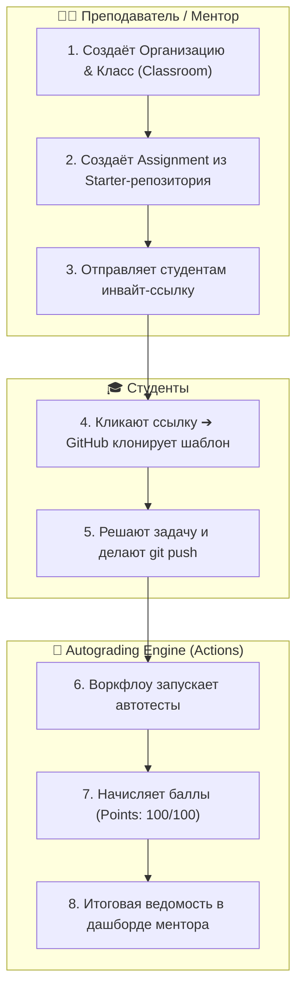
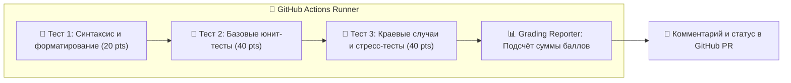

# 🧪 GitHub Classroom & Автогрейдинг: Автоматическая проверка заданий через GitHub Actions

> **«Преподаватель должен объяснять архитектуру и вдохновлять, а рутину проверки синтаксиса и тестов обязаны выполнять бездушные роботы.»**  
> *— Из наставлений Офицера Разведки*

Каждый сильный разработчик рано или поздно становится ментором: обучает стажёров в компании, ведёт курс в университете, организует корпоративный буткемп или запускает собственный open-source полигон.

Проверять десятки и сотни студенческих репозиториев вручную — это путь к выгоранию и потере времени. Платформа **GitHub Classroom** (`classroom.github.com`) в связке с **GitHub Actions Autograding** позволяет полностью автоматизировать учебный процесс: от создания персональных изолированных репозиториев до мгновенного прогона тестов и начисления баллов.

---

## 🏛️ Что такое GitHub Classroom и как он устроен



GitHub Classroom — это официальный бесплатный надстроечный сервис над GitHub Organizations:
1. **Единая учебная организация (GitHub Organization):** Все репозитории студентов живут внутри одной контролируемой организации преподавателя, а не разбросаны по личным аккаунтам.
2. **Индивидуальные и командные задания (Individual vs Group Assignments):** Возможность выдавать задания как одиночным студентам, так и командам по 3–5 человек с общим репозиторием.
3. **Автоматическое клонирование из шаблона (Starter Code):** Студенту достаточно кликнуть специальную ссылку (`https://classroom.github.com/a/...`), и GitHub сам создаст приватный репозиторий с его никнеймом (например, `lab-01-python-studentname`) и скопирует туда стартовый код.
4. **Ростер (Student Roster):** Таблица сопоставления никнеймов GitHub с реальными именами студентов из университетского списка или корпоративного реестра.

---

## ⚙️ Анатомия автогрейдинга (Autograding Engine)

В основе автоматической проверки заданий лежит официальный набор экшенов GitHub Classroom:
* `classroom-resources/autograding-io-grader`: Проверка консольного ввода/вывода (I/O Tests). Подаёт на `stdin` тестовые данные и сравнивает `stdout` программы студента с эталоном.
* `classroom-resources/autograding-command-grader`: Запуск произвольных команд сборки и юнит-тестов (Pytest, JUnit, Jest, Cargo test).
* `classroom-resources/autograding-grading-reporter`: Финальный сборщик очков, формирующий итоговый балл (например, `Points 80/100`) и выставляющий статусный бейдж в Pull Request.



---

## 🛠️ Эталонный воркфлоу автогрейдинга (`.github/workflows/classroom.yml`)

Ниже приведён боевой шаблон конвейера для проверки лабораторной работы на Python (Pytest):

```yaml
name: GitHub Classroom Autograding

on:
  push:
    branches: [ main, master ]
  pull_request:
    branches: [ main, master ]

permissions:
  checks: write
  actions: read
  contents: read

jobs:
  build-and-test:
    name: Autograding Tests
    runs-on: ubuntu-latest
    timeout-minutes: 5 # 🛑 Железный стоп-кран против бесконечных циклов

    steps:
      - name: Скачивание кода студента
        uses: actions/checkout@v4

      - name: Настройка среды Python 3.11
        uses: actions/setup-python@v5
        with:
          python-version: '3.11'

      - name: Установка тестовых зависимостей
        run: |
          python -m pip install --upgrade pip
          pip install pytest pytest-timeout

      # -------------------------------------------------------------
      # Тест 1: Проверка базовой логики функции (30 баллов)
      # -------------------------------------------------------------
      - name: Test Basic Logic
        id: test-basic
        uses: classroom-resources/autograding-command-grader@v1
        with:
          test-name: "Базовая функциональность (Unit Tests)"
          command: "pytest tests/test_basic.py -v"
          timeout: 1
          max-score: 30
          setup-command: ""

      # -------------------------------------------------------------
      # Тест 2: Проверка обработки ошибок и краевых случаев (40 баллов)
      # -------------------------------------------------------------
      - name: Test Edge Cases
        id: test-edge
        uses: classroom-resources/autograding-command-grader@v1
        with:
          test-name: "Краевые случаи и валидация аргументов"
          command: "pytest tests/test_edge.py -v"
          timeout: 1
          max-score: 40
          setup-command: ""

      # -------------------------------------------------------------
      # Тест 3: Консольный ввод/вывод программы (30 баллов)
      # -------------------------------------------------------------
      - name: Test CLI I/O
        id: test-cli
        uses: classroom-resources/autograding-io-grader@v1
        with:
          test-name: "Консольный интерфейс CLI (I/O Test)"
          command: "python src/main.py"
          input: "42\n"
          expected-output: "Результат: 84"
          comparison-method: "included"
          timeout: 1
          max-score: 30

      # -------------------------------------------------------------
      # Итоговый репортер баллов
      # -------------------------------------------------------------
      - name: Autograding Reporter
        uses: classroom-resources/autograding-grading-reporter@v1
        env:
          TEST-BASIC_RESULTS: "${{ steps.test-basic.outputs.result }}"
          TEST-EDGE_RESULTS: "${{ steps.test-edge.outputs.result }}"
          TEST-CLI_RESULTS: "${{ steps.test-cli.outputs.result }}"
        with:
          runners: test-basic,test-edge,test-cli
```

---

## 🛡️ OPSEC & Anti-Cheat: Защита автогрейдера от взлома

Студенты — находчивые исследователи. Если ментор настроил автогрейдинг наивно, студенты быстро найдут лазейки:
1. Отредактируют файл тестов `test_basic.py`, заменив `assert result == 42` на `assert True`.
2. Отредактируют сам файл воркфлоу `.github/workflows/classroom.yml`, захардкодив `max-score: 100`.

### 🗝️ Как защитить репозиторий задания (Протокол безопасности):

| Уязвимость | Как пытается взломать студент | Архитектурная защита разведки |
| :--- | :--- | :--- |
| **Подделка тестов** | Удаление или изменение ассертов в файлах `tests/*.py` | Скачивание эталонных тестов во время выполнения воркфлоу из скрытого приватного репозитория ментора по токену, либо сверка sha256-хэша тестовых файлов перед запуском |
| **Правка workflow** | Изменение `.github/workflows/classroom.yml` | Включение **Repository Rulesets** или **Protected Branches**, запрещающих изменение каталога `.github/` обычным контрибьюторам |
| **Зависание ранера** | Бесконечный цикл `while True:` или утечка памяти | Обязательные параметры `timeout-minutes: 5` на уровне job и флаг `--timeout=10` в тестовом фреймворке |
| **Утечка секретов** | Студент пишет `print(os.environ)` в коде | Использование изолированного окружения без передачи секретов организации в джоб студента |

---

## 🌟 Живой пример: Как устроен автогрейдер в курсе «GitHub от А до Я»

В нашем собственном образовательном проекте уже реализована эталонная архитектура автогрейдинга!

Взгляните на нашего робота **Graduate PR Verifier**:
* **Воркфлоу:** [`.github/workflows/graduate-verifier.yml`](https://github.com/thedoctormes-hue/github-a-to-z/blob/main/.github/workflows/graduate-verifier.yml) перехватывает событие `pull_request_target`.
* **Скрипт проверки:** [`scripts/verify_graduate_pr.py`](https://github.com/thedoctormes-hue/github-a-to-z/blob/main/scripts/verify_graduate_pr.py) автоматически:
  1. Проверяет, что затронут **строго один файл** (`GRADUATES.md`);
  2. Валидирует структуру Markdown-таблицы (ровно 6 колонок);
  3. Проверяет никнейм автора на Identity Spoofing (нельзя добавить чужой ник);
  4. При успехе ставит зелёную галочку CI, присваивает лейбл `graduate-verified` и оставляет приветственный комментарий с инструкцией.

Это наглядное доказательство студентам: **автогрейдинг — это не абстрактная теория, а фундамент современных инженерных процессов 2026 года**!

---

## 🎯 Чек-лист преподавателя: Запуск первого задания за 5 минут

- [ ] Создана бесплатная организация на GitHub для курса (например, `university-cs-2026`).
- [ ] Оформлена заявка на [GitHub Teacher Toolbox](https://education.github.com/teachers) для получения бесплатных минут Actions и Pro-прав.
- [ ] Подключён сервис [classroom.github.com](https://classroom.github.com).
- [ ] Подготовлен стартовый репозиторий-шаблон (Starter Repo) с кодом задания и настроенным workflow `.github/workflows/classroom.yml`.
- [ ] В воркфлоу установлены таймауты `timeout-minutes: 5`.
- [ ] Сгенерирована инвайт-ссылка задания и отправлена ученикам в чат курса.

👉 **Следующий шаг:** Изучите смежные стандарты платформы в [Модуле 6: Роботы на службе (Actions & Pages)](../06-actions-pages/README.md) и проверьте свои знания в [Тренажёре сертификации GitHub Foundations](../certification/foundations.md)!
