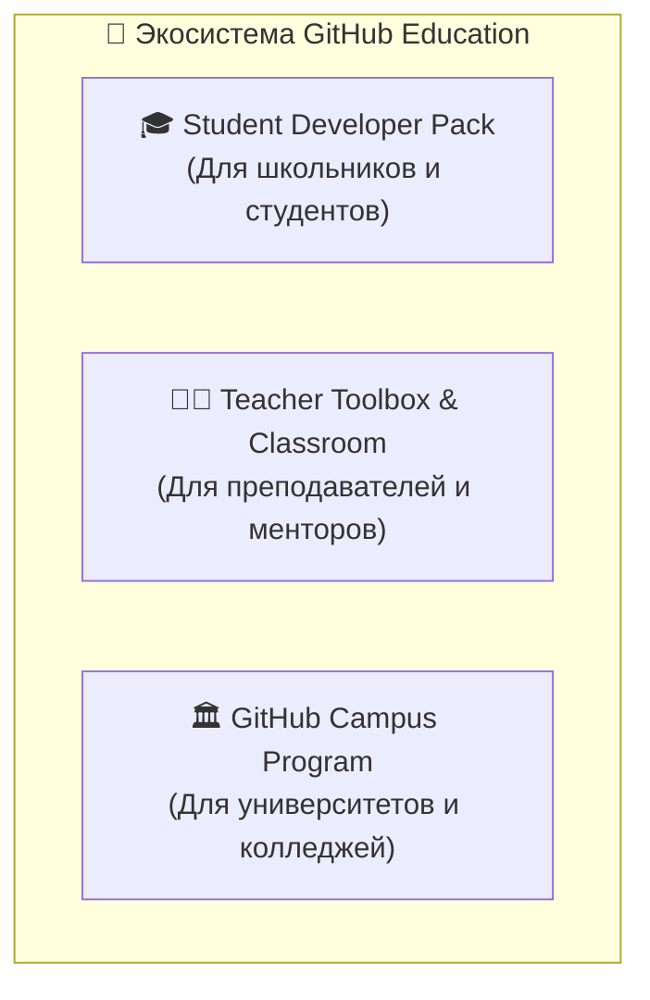
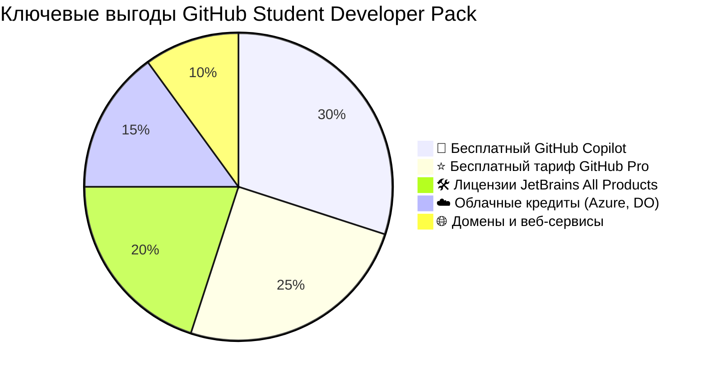
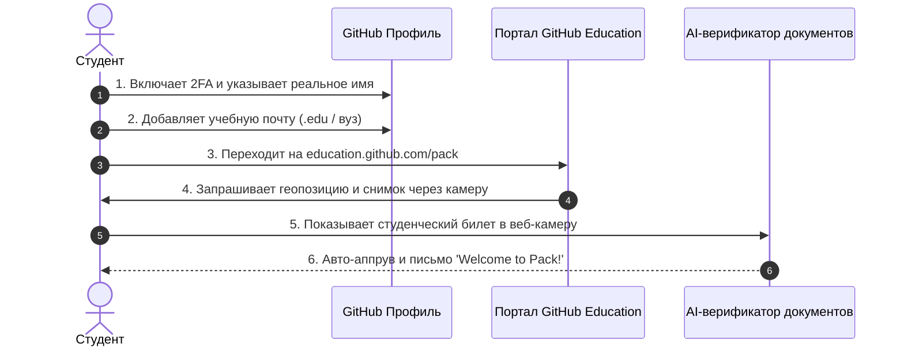

# 🎒 GitHub Education & Student Developer Pack: Бесплатный Pro, Copilot и арсенал на $200,000+

> **«Инженерный арсенал стоит дорого, но для тех, кто учится, разведка открывает парадные двери бесплатно.»**  
> *— Из наставлений Офицера Разведки*

Для миллионов начинающих инженеров финансовый барьер часто становится препятствием: подписки на среды разработки, облачные серверы, доменные имена и платные AI-ассистенты требуют сотен долларов в год.

Компания GitHub и её технологические партнёры создали крупнейшую в мире благотворительную инженерную программу — **GitHub Student Developer Pack**. В этой главе мы разберём, как легально получить этот арсенал стоимостью свыше **$200,000**, избежать подводных камней при верификации и выжать максимум пользы для своей карьеры.

---

## 🏛️ Что такое GitHub Education: Три крыла программы

1. **GitHub Student Developer Pack:** Пакет бесплатных подписок, инструментов и облачных кредитов для каждого учащегося в возрасте от 13 лет.
2. **GitHub Teacher Toolbox & GitHub Classroom:** Инфраструктура для преподавателей, позволяющая создавать учебные курсы, автоматически раздавать репозитории студентам и проверять домашние задания роботом (Autograding).
3. **GitHub Campus Program:** Институциональное партнёрство, дающее учебному заведению бесплатный GitHub Enterprise для всех кафедр.

---

## 💎 Главные жемчужины студенческого пакета

### 1. ⭐ Вечный бесплатный тариф GitHub Pro
На всё время вашего обучения личный аккаунт бесплатно переводится на тариф **GitHub Pro** (обычная цена: $4/месяц):
* **Приватные сайты на GitHub Pages:** Возможность хостить сайты и документацию из закрытых репозиториев (в обычном Free доступно только для Public).
* **3000 минут GitHub Actions в месяц** (вместо стандартных 2000 минут) для запуска тестов и деплоя.
* **2 ГБ хранилища GitHub Packages (GHCR)** (вместо 500 МБ) для Docker-контейнеров и пакетов.
* **Продвинутый контроль веток:** Защищенные ветки в приватных репозиториях, обязательные ревьюеры, автоназначение через `CODEOWNERS`.
* **Бейдж `PRO`:** Официальная плашка в профиле GitHub рядом с вашим аватаром.

### 2. 🤖 Бесплатный GitHub Copilot Individual
* Доступ к самому мощному ИИ-ассистенту для парного программирования в VS Code, JetBrains, Visual Studio, Neovim и GitHub CLI.
* Неограниченные подсказки автодополнения кода и диалоги в чате Copilot Chat.
* **Экономия:** $10/месяц ($120 в год).

### 3. 🛠️ Золотой фонд партнерского софта (Топ-10 бонусов)

| Партнёр / Инструмент | Что предоставляется | Реальная стоимость | Как применить в учебе |
| :--- | :--- | :---: | :--- |
| **JetBrains** | Полный пакет All Products Pack (IntelliJ IDEA Ultimate, PyCharm Pro, WebStorm, GoLand, CLion и др.) | ~$289 / год | Профессиональная разработка на любых языках без ограничений Community-версий |
| **Namecheap & .me** | 1 бесплатный домен `.me` на 1 год + бесплатный SSL-сертификат | ~$20 / год | Персональное портфолио: привязка своего красивого домена `имя.me` к GitHub Pages |
| **Microsoft Azure** | $100 облачных кредитов ежегодно + бесплатный доступ к популярным сервисам без привязки кредитной карты | $100 / год | Развёртывание баз данных, виртуальных машин и микросервисов в облаке |
| **DigitalOcean** | $200 кредитов на 1 год для новых пользователей | $200 | Запуск собственных VPS (Droplets), ботов, VPN или Docker-контейнеров |
| **1Password** | Бесплатная подписка на менеджер паролей на 1 год | ~$36 / год | Железная цифровая гигиена (OPSEC): безопасное хранение мастер-паролей и ключей |
| **FrontendMasters** | 6 месяцев бесплатного доступа ко всем курсам платформы | ~$234 | Глубокое изучение JavaScript, TypeScript, React, Vue, CSS и архитектуры веба |
| **DataCamp** | 3 месяца бесплатной подписки на курсы по Data Science и AI | ~$75 | Практика Python, SQL, машинного обучения и анализа данных на реальных кейсах |
| **Termius** | Премиум-клиент SSH и SFTP для настольных систем и смартфонов | ~$120 / год | Удобное и безопасное подключение к серверам с синхронизацией ключей и сниппетов |
| **Bootstrap Studio** | Бессрочная лицензия на визуальный редактор веб-интерфейсов | $60 | Молниеносная сборка адаптивных лендингов и веб-страниц |
| **Canva Pro** | 1 год бесплатной подписки на дизайн-платформу | ~$120 / год | Создание баннеров для репозиториев, превью-картинок, схем и резюме |

---

## 🎯 Кто имеет право на получение (Критерии допуска)

Чтобы претендовать на GitHub Student Developer Pack, вы должны соответствовать следующим базовым требованиям:

1. **Возраст:** Не менее 13 лет.
2. **Статус учащегося:** Вы зачислены на курс обучения, результатом которого является получение диплома, аттестата или сертификата:
   * Учащиеся средних школ, лицеев, гимназий;
   * Студенты колледжей, техникумов;
   * Студенты университетов (бакалавриат, специалитет, магистратура, аспирантура);
   * Слушатели авторизованных образовательных программ и курсов переквалификации (при наличии официального подтверждения от учебного заведения).
3. **Форма обучения:** Подходит любая — очная, очно-заочная, заочная или дистанционная.
4. **Учётная запись GitHub:** Активный персональный аккаунт с включённой двухфакторной аутентификацией (2FA).

---

## 🕵️ Пошаговый протокол подачи заявки (Анти-Реджект)

> [!WARNING]
> **⚠️ Внимание: Ужесточение антифрод-контроля GitHub**  
> В последние годы GitHub ужесточил алгоритмы проверки из-за наплыва мошенников. Ручная загрузка сканов файлов (`.pdf` или картинок с диска) **отключена** — теперь снимок документа делается **исключительно через живую веб-камеру вашего устройства в реальном времени**.

Следуйте строгому чек-листу разведки, чтобы пройти проверку с первой попытки:

### Фаза 1: Подготовка профиля (До подачи)
1. **Включите 2FA:** Перейдите в [Settings ➔ Password and authentication](https://github.com/settings/security) и активируйте двухфакторную аутентификацию (через приложение-аутентификатор или ключ безопасности). Без 2FA кнопка подачи заявки даже не откроется.
2. **Укажите реальное имя:** В [Settings ➔ Public profile](https://github.com/settings/profile) заполните поле **Name** в точности так, как написано в вашем студенческом документе (на русском или латинице). Если в профиле никнейм вместо имени, система заподозрит фейк.
3. **Добавьте учебный email:** В [Settings ➔ Emails](https://github.com/settings/emails) добавьте почту вашего учебного заведения (например, `ivanov@student.msu.ru` или `petr@university.edu`). Подтвердите её по ссылке из входящего письма.
   *(Если у вашего вуза нет студенческой почты — не страшно, можно подавать с обычной личной почты, но потребуется более строгое визуальное подтверждение).*

### Фаза 2: Подача заявки на портале
1. Перейдите на официальный портал: **[https://education.github.com/pack](https://education.github.com/pack)**.
2. Нажмите зелёную кнопку **«Sign up for Student Developer Pack»** ➔ выберите роль **Student**.
3. Если у вас привязана учебная почта, выберите её в выпадающем списке.
4. В поле поиска учебного заведения начните вводить название вашей школы или университета на английском или русском языке.
5. В поле «How do you plan to use GitHub?» напишите 2–3 честных предложения на английском (например:  
   *«I am a computer science student learning Git, Python, and web development. I plan to use GitHub for coursework assignments, collaborating with classmates, and hosting portfolio projects on GitHub Pages.»*).

### Фаза 3: Фотографирование документа (Момент истины)
1. Разрешите браузеру доступ к **веб-камере** и **геолокации** (Geolocation API).
   > [!IMPORTANT]
   > **Географический радар:** Обязательно **отключите любые VPN и прокси**! Если вы учитесь в Москве или Екатеринбурге, а ваш IP-адрес показывает Нидерланды или Сингапур, заявка будет автоматически отклонена антифрод-системой из-за несовпадения координат.
2. Подготовьте физический документ:
   * **Студенческий билет** (разворот с вашей фотографией, печатью и продлением на текущий учебный год);
   * **Зачётную книжку** (страница с актуальным семестром);
   * **Справку об обучении** из деканата/канцелярии (с датой выдачи, круглой печатью и подписью);
   * **Школьную справку** с печатью школы.
3. Поднесите документ к веб-камере:
   * Обеспечьте хорошее освещение (без солнечных бликов и глубоких теней);
   * Убедитесь, что **текст резкий и легко читается**;
   * Дата действия (текущий год) и ваше имя должны быть отчётливо видны;
   * Не закрывайте пальцами печати и даты.
4. Сделайте снимок и отправьте заявку.

### Фаза 4: Верификация и результат
* **Автоматическое одобрение (Fast-track):** Если документ идеален, а почта с доменом вуза, подтверждение приходит в течение **2–10 минут**!
* **Ручная проверка (Manual review):** При обычной почте проверка занимает от **24 часов до 5 рабочих дней**.
* При успешной верификации в вашем профиле мгновенно загорится бейдж **`PRO`**, а на почту придёт уведомление:  
  *«Welcome to the GitHub Student Developer Pack!»*.

---

## 🛡️ Разбор типичных ошибок: Почему отклоняют заявки

Если ваша заявка вернулась со статусом `Rejected`, найдите причину в досье разведки:

| Причина отказа (Текст ошибки) | В чём корень проблемы | Как мгновенно исправить |
| :--- | :--- | :--- |
| **«Your document does not include a date»** | На фото не видна дата окончания срока действия или текущий учебный год | Предоставьте страницу студенческого с актуальным штампом продления или возьмите свежую справку с датой |
| **«Your name on profile does not match document»** | В профиле указан никнейм (`SuperCoder2026`) вместо реального ФИО | Укажите реальные имя и фамилию в Settings ➔ Public profile точно как в документе |
| **«You appear not to be near your campus»** | Включён VPN, либо вы подаёте заявку из другого полушария | Отключите VPN, подключитесь к домашнему или университетскому Wi-Fi, разрешите геопозицию |
| **«Image is too blurry to read»** | Размытый фокус дешёвой веб-камеры ноутбука | Протрите объектив, обеспечьте яркий свет, либо подключите смартфон как веб-камеру через DroidCam/Camo |
| **«Uploaded files are not accepted»** | Попытка обойти съёмку через виртуальную камеру или эмуляторы | Используйте реальную камеру и физический бумажный документ |

---

## 🔄 Продление и жизнь после выпуска

1. **Срок действия пакета:**  
   Студенческий статус обычно выдаётся на **1–2 года** (либо до указанной в справке даты окончания обучения).
2. **Как продлить (Re-apply):**  
   За 30 дней до окончания срока GitHub пришлёт письмо с напоминанием. Вам достаточно снова зайти на `education.github.com/pack` и подтвердить актуальный статус продлённым студенческим или новой справкой.
3. **Что произойдёт после выпуска из университета:**  
   Когда вы закончите обучение, ваш аккаунт мягко перейдёт на стандартный тариф **GitHub Free**.  
   * **Ни один репозиторий не удалится и не заблокируется!**  
   * Вся история коммитов, код и проекты останутся в целости и сохранности навсегда.

---

## 🎯 Чек-лист курсанта перед подачей

- [ ] В моём аккаунте GitHub активирована двухфакторная аутентификация (2FA).
- [ ] В поле `Name` профиля указаны мои настоящие имя и фамилия.
- [ ] Документ подтверждает мой статус на **текущий календарный год**.
- [ ] VPN и прокси полностью отключены.
- [ ] Браузер имеет доступ к камере и геолокации.
- [ ] Текст на снимке камеры чёткий, резкий и без бликов.

👉 **Следующий шаг:** Переходите на [education.github.com/pack](https://education.github.com/pack), забирайте свой законный арсенал и привязывайте бесплатный домен `.me` к своему [GitHub Pages портфолио](../06-actions-pages/README.md#6-бесплатный-хостинг-запуск-сайта-на-github-pages)!
