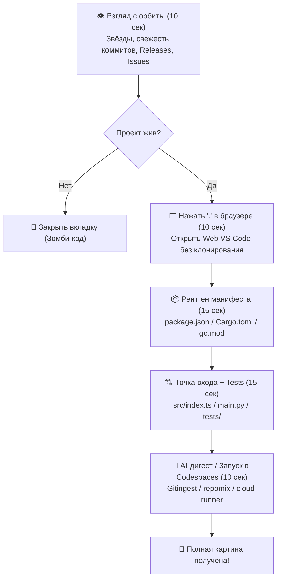

# 🛰️ Спецгайд: Скоростная разведка любого репозитория (Repository Reconnaissance 2026)

> **«Никогда не делай `git clone` вслепую, пока не поймёшь, с чем имеешь дело».**  
> Методическое руководство по экспресс-декомпозиции, аудиту и исследованию чужих репозиториев за 60 секунд без засорения локальной машины.

[](#)
[](#)
[](#)

---

## 🧭 Навигация по гайду

* [⏱️ 60-секундный протокол рекогносцировки](#60-секундный-протокол-рекогносцировки)
* [👁️ Слой 1: Витальные маркеры жизнеспособности (Pulse & Health)](#слой-1-витальные-маркеры-жизнеспособности-pulse-health)
* [⌨️ Слой 2: Горячие клавиши браузерной разведки (Web Shortcuts)](#слой-2-горячие-клавиши-браузерной-разведки-web-shortcuts)
* [📦 Слой 3: Рентген манифестов зависимостей (Стек & Архитектура)](#слой-3-рентген-манифестов-зависимостей-стек-архитектура)
* [🏗️ Слой 4: Поиск точек входа и сборки (Entrypoints & Build)](#слой-4-поиск-точек-входа-и-сборки-entrypoints-build)
* [🧪 Слой 5: Тесты как честная документация API](#слой-5-тесты-как-честная-документация-api)
* [☁️ Слой 6: Бесконтактный запуск (Zero-Footprint via Codespaces)](#слой-6-бесконтактный-запуск-zero-footprint-via-codespaces)
* [🤖 Слой 7: Разведка через нейросети и AI-агентов](#слой-7-разведка-через-нейросети-и-ai-агентов)
* [🚩 Красные флаги и аудит безопасности (Red Flags)](#красные-флаги-и-аудит-безопасности-red-flags)
* [📋 Чек-лист разведчика (Шпаргалка для терминала)](#чек-лист-разведчика-шпаргалка-для-терминала)

---

## ⏱️ 60-секундный протокол рекогносцировки

Когда современный инженер находит интересный репозиторий, он не бросается копировать URL для клонирования. Он применяет **60-секундный протокол декомпозиции**:



---

## 👁️ Слой 1: Витальные маркеры жизнеспособности (Pulse & Health)

Первые 10 секунд на главной странице репозитория дают 80% информации о состоянии проекта:

| Параметр | Здоровый проект 🟢 | Зомби / Токсичный проект 🔴 | Где смотреть |
| :--- | :--- | :--- | :--- |
| **Последний коммит** | Дни или недели назад | > 1.5–2 лет назад | Верхний блок файлов в UI |
| **Релизный цикл** | Регулярные теги SemVer (`v2.4.0`) | Релизов нет или последний в 2021 году | Правый сайдбар: *Releases* |
| **Баланс Issues** | Тикеты обсуждаются и закрываются | Сотни открытых тикетов без единого ответа | Вкладка *Issues* |
| **Скорость реакции PR** | Мержи или аргументированные отзывы | Десятки висящих PR от комьюнити без внимания | Вкладка *Pull Requests* |
| **Лицензия** | Понятный Open Source (MIT, Apache 2.0, BSD) | Отсутствует (*All Rights Reserved*) или капканы (SSPL, BSL) | Корень: `LICENSE` |
| **Зелёный CI** | Бейдж CI зелёный, проверки проходят | Красный крест на последнем коммите `main` | Возле хэша коммита |

> [!TIP]
> **Трюк со Star History:** Чтобы понять, органический ли это интерес или разовый хайп/накрутка, замените в адресной строке `github.com` на `star-history.com/#owner/repo`. Плавный экспоненциальный рост — признак здорового сообщества.

---

## ⌨️ Слой 2: Горячие клавиши браузерной разведки (Web Shortcuts)

Вам не нужно скачивать 2 гигабайта кода, чтобы исследовать структуру. GitHub оснащён мощной клавиатурной навигацией прямо на любой веб-странице:

| Клавиша | Действие | Зачем нужно разведчику |
| :---: | :--- | :--- |
| **`.`** | **Web VS Code (`github.dev`)** | Мгновенно разворачивает полноценный редактор VS Code прямо во вкладке браузера со всем деревом файлов и поиском. |
| **`t`** | **File Finder** | Мгновенный поиск файлов по нечёткому названию (Fuzzy Search). Введите `config` или `auth` — и файл перед вами. |
| **`/`** | **Символьный поиск** | Переносит фокус в строку глобального поиска GitHub Code Search с поддержкой регулярных выражений и символов. |
| **`w`** | **Переключатель веток и тегов** | Быстрый выбор нужного релиза или feature-ветки без скролла мышью. |
| **`b`** | **Git Blame текущего файла** | Показывает, кто, когда и в рамках какого PR менял каждую строчку файла. |
| **`l`** | **Jump to Line** | Быстрый переход к конкретному номеру строки в открытом файле. |
| **`y`** | **Канонический Permalink** | Превращает URL страницы в неизменяемую ссылку с постоянным SHA-хэшем коммита (идеально для шаринга в чатах). |
| **`?`** | **Все шорткаты GitHub** | Открывает модальное окно полного списка горячих клавиш платформы. |

---

## 📦 Слой 3: Рентген манифестов зависимостей (Стек & Архитектура)

Опытный инженер открывает не исходный код, а **манифест зависимостей**. Это генетический паспорт проекта:

```text
Node.js / TS  ──> package.json (dependencies, scripts, workspaces)
Python        ──> pyproject.toml / requirements.txt / poetry.lock
Rust          ──> Cargo.toml ([dependencies], [features])
Go            ──> go.mod (require, replace, go version)
Java / Kotlin ──> pom.xml / build.gradle.kts
```

### На что смотреть в манифесте:
1. **Секция `scripts` (в Node/Python):**
   - Какие команды предусмотрены авторами? (`dev`, `build`, `test`, `lint`, `codegen`).
   - Если есть команда `test`, значит культура качества в проекте присутствует.
2. **Количество и состав зависимостей:**
   - Легковесный стек (5–10 проверенных библиотек) говорит о зрелой архитектуре.
   - Раздутый список из 150 сомнительных библиотек с миллионом транзитивных зависимостей — потенциальный кошмар безопасности.
3. **Монорепозиторий или микросервисы:**
   - Наличие полей `workspaces: ["packages/*", "apps/*"]` сразу раскрывает архитектурный масштаб.

---

## 🏗️ Слой 4: Поиск точек входа и сборки (Entrypoints & Build)

Каждый проект живёт вокруг своих «главных артерий»:

1. **Точка сборки и автоматизации:**
   - Ищите в корне: `Makefile`, `Taskfile.yml`, `justfile`, `Dockerfile`, `docker-compose.yml`.
   - Если в `Makefile` есть понятные цели `make setup`, `make test`, `make run` — онбординг займёт ровно 2 минуты.
2. **Точка инициализации кода (Entrypoint):**
   - В Node.js / TypeScript: поле `main` или `exports` в `package.json`, либо `src/index.ts`, `src/main.ts`.
   - В Python: `main.py`, `app.py` или `__main__.py` внутри пакета.
   - В Go: папка `cmd/<app-name>/main.go`.
   - В Rust: `src/main.rs` (для бинарников) или `src/lib.rs` (для библиотек).
3. **Пайплайны автоматизации (`.github/workflows/`):**
   - Загляните в файлы `.github/workflows/*.yml`.
   - Что тестируется перед мержем? Под капотом запускается один линтер или прогоняется матрица тестов на Linux/macOS/Windows с SAST-сканером CodeQL?

---

## 🧪 Слой 5: Тесты как честная документация API

> *«Документация может врать из-за documentation drift. Тесты врать не могут — иначе CI будет красным».*

Откройте каталог `tests/`, `__tests__/` или `spec/`:
* **Unit-тесты:** покажут, как авторы ожидали использование своих классов и функций в изолированном виде.
* **E2E / Integration тесты:** покажут реальный пользовательский сценарий от инициализации до получения результата.
* **Качество описаний:** если названия тестов звучат как бизнес-требования (`it('should reject expired tokens with 401')`), перед вами проект высочайшего уровня.

---

## ☁️ Слой 6: Бесконтактный запуск (Zero-Footprint via Codespaces)

Вам нужно запустить проект, проверить CLI-утилиту или протестировать API, но вы не хотите ставить в свою операционную систему чужую версию Python, Node.js или базы данных?

1. **GitHub Codespaces (Облачная песочница):**
   - Нажмите зелёную кнопку **`<> Code`** ➔ вкладка **`Codespaces`** ➔ **`Create codespace on main`**.
   - За 30–60 секунд GitHub выделит изолированную виртуальную машину в облаке с готовым VS Code в браузере или подключением к вашему локальному VS Code.
   - Проект запускается в чистом контейнере с пробросом портов на защищённые HTTPS-ссылки.
2. **Dev Containers (`.devcontainer/devcontainer.json`):**
   - Если в репозитории есть папка `.devcontainer`, проект настроен идеально: все расширения редактора, системные утилиты и базы поднимаются автоматически.
3. **После работы:**
   - Просто удалите Codespace в один клик в меню [github.com/codespaces](https://github.com/codespaces). Ноль мусора на вашем компьютере.

---

## 🤖 Слой 7: Разведка через нейросети и AI-агентов

В 2026 году ручное чтение 50 000 строк кода чужого репозитория — это архаизм. Используйте нейросетевую оптику:

### 1. Метод Gitingest (Моментальный дайджест в один клик)
Замените `hub` на `ingest` в адресной строке любого репозитория:
```text
https://github.com/owner/repository
           ↓↓↓
https://gitingest.com/owner/repository
```
Сервис мгновенно сформирует единый сжатый текстовый файл с деревом файлов и ключевым содержимым, готовый для вставки в ChatGPT, Claude или Gemini.

### 2. Метод Repomix (Локальный упаковщик контекста)
Если вам нужен ювелирный контроль над тем, какие файлы скармливать агенту, запустите в терминале:
```bash
npx repomix
```
Утилита создаст файл `repomix-output.txt` или `.md`, отфильтровав бинарники, lock-файлы и тяжелые ассеты.

### 3. Промпты для мгновенного архитектурного аудита
Скопируйте этот проверенный промпт и скормите его LLM вместе с контекстом репозитория:

```markdown
Ты — старший системный архитектор и специалист по безопасности. 
Я передаю тебе срез репозитория [ИМЯ_ПРОЕКТА].
Сделай экспресс-аудит по следующим пунктам:
1. Архитектурный рентген: назови точку входа, опиши путь прохождения данных от инициализации до финала и выдели ключевые слои.
2. Стек и зрелость: оцени актуальность библиотек и выяви потенциальный технический долг или антипаттерны.
3. Безопасность и слабые места: найди потенциальные уязвимости в конфигурациях, обработке секретов и зависимостях.
4. Качество инженерной культуры: оцени тесты, CI/CD пайплайны и удобство онбординга разработчика.
Выдай ответ строго по делу, структурированно, без общих фраз.
```

---

## 🚩 Красные флаги и аудит безопасности (Red Flags)

Если при беглом осмотре вы замечаете хотя бы 2 пункта из списка ниже — будьте предельно осторожны при запуске кода:

* 🚨 **Токсичные лицензии / Отсутствие лицензии:**
  Если файла `LICENSE` нет, по умолчанию действует режим *«Все права защищены»* — вы юридически не имеете права использовать этот код в компании. Если лицензия сменилась на BSL/SSPL — проект закрывается от свободного использования.
* 🚨 **Секреты и ключи в истории Git:**
  В репозитории случайно закоммичен `.env` или приватные ключи? Это симптом критически низкой культуры безопасности авторов.
* 🚨 **Один мейнтейнер («Фактор автобуса» = 1):**
  Посмотрите вкладку *Insights ➔ Contributors*. Если 99% коммитов сделаны одним человеком 3 года назад, а Issues висят без ответов — проект брошен.
* 🚨 **Отсутствие CI и тестов:**
  Код коммитится прямо в `main` без проверок, линтеров и сборки.
* 🚨 **Замороженные уязвимые зависимости:**
  Манифест зависимостей зафиксирован на древних версиях, подверженных известным CVE.

---

## 📋 Чек-лист разведчика (Шпаргалка для терминала)

Сохраните себе эту последовательность шагов:

```text
[ ] 1. Оценить дату последнего релиза и коммита в main.
[ ] 2. Проверить наличие и тип лицензии (LICENSE).
[ ] 3. Нажать '.' и открыть Web VS Code.
[ ] 4. Изучить манифест зависимостей (package.json / Cargo.toml / pyproject.toml).
[ ] 5. Найти точку входа (Entrypoint) и точку запуска (Makefile / Dockerfile).
[ ] 6. Оценить каталог тестов (tests/).
[ ] 7. Проверить воркфлоу в .github/workflows/.
[ ] 8. При необходимости глубокого анализа — скормить через gitingest / repomix в LLM.
[ ] 9. При необходимости интерактивного теста — запустить в GitHub Codespaces.
```

---

*Спецгайд подготовлен в рамках курса [«GitHub от А до Я»](../README.md). Изучайте чужой опыт, перенимайте лучшие стандарты и защищайте свой периметр.* 👁️🥀
